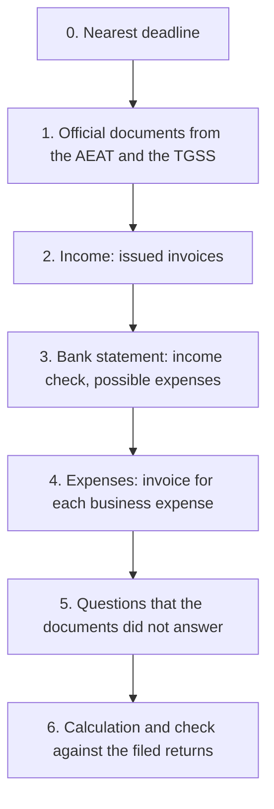

*Translated from the Spanish original [docs/onboarding.md](../onboarding.md) on 13.10.2026. The Spanish file is the source of truth.*

# Setting up a profile: what to upload, what to ask, what to clarify

Canonical order for a new autónomo profile. The goal is to fill in all the returns of the year
from documents, not from the user's memory. Rule: **an official document is worth more than the answer to a question,
and the answer to a question is worth more than a guess by gestor from the bank statement.** Each guess is shown to the user so that
the user confirms it. No guess enters the calculation without a warning.

## 0. Nearest deadline

The first thing gestor does is show the nearest filing deadline (normally the 20th day after the quarter) and what it needs.
If fewer than 15 days are left, steps 1–4 are done only for that quarter. The rest comes after filing.

## 1. Official documents (upload as PDF)

These documents answer most of the questionnaire and establish the truth. All of them are downloaded with Cl@ve.

| Document | Where to get it | What gestor takes from it |
|---|---|---|
| Certificado de situación censal | Sede AEAT → Todas las gestiones → Certificados → Censales → Situación Censal | Name, NIE, tax address, alta date, epígrafe IAE, IVA and IRPF regime, Registro de Operadores Intracomunitarios (ROI), **list of obligations that the AEAT expects**: it is checked against «What you file» |
| Filed returns of the current year and the previous year (303, 130, 349, 390, 347, 100 or 151) | Sede AEAT → Área personal → Mis expedientes → Consultar declaraciones presentadas | «Filed» marks with amounts, IVA cuotas a compensar, net return of the previous year (casilla 13 of the 130, 70 % exemption) |
| Modelo 149 and the decision on it | Sede AEAT, the same section | Whether the régimen Beckham is in force and from which year |
| Status report / bases de cotización | Import@ss (TGSS) | Alta date in the RETA, current base, tarifa plana period |
| Residence permit (TIE) | the user has it | Type of visa or residence permit, validity |
| NRC lookup of the payments (if the statement has an unexplained «Tax payment») | Sede AEAT → Pagar, aplazar y consultar → Consultar deudas → Consulta pagos anteriores y Anulación Nrcs | Which return was paid with that payment |

If a document is missing, the question from step 5 is asked instead. The answer is marked «according to the user».

## 2. Income (upload)

- All issued invoices of the year as PDF: number, date, client, amount, currency.
- Series and last invoice number with the previous gestor: the numbering continues without gaps.
- For each client: full name, address, country, tax number (VAT ID for the EU), whether it is a business or a private person.
- Contract with the client, if the place of supply of the service is not obvious.

## 3. Bank statement (upload as xlsx or csv)

The statement is not a document for the tax office. It serves two checks:

1. **Each payment from a client ↔ one invoice.** A payment without an invoice creates a question to the user: is it payment for work, a refund, a transfer from a family member, personal money?
2. **Possible business expenses.** gestor groups the debits and asks only about the unclear ones:
   - certainly business: contributions to the TGSS (RETA), gestoría services, tax payments (they are not an expense; they serve to check against the returns);
   - possibly business: software and subscriptions, telephone and internet, coworking, travel, equipment;
   - household, partly deductible if you work from home: rent, electricity, water (share of the floor area; for utilities, 30 % of that share);
   - personal: food, leisure, transfers to people, cash.

The bank fee for a received transfer is a business expense if the transfer is the payment of an invoice.

Your agent does this check through the MCP server: `/mcp__gestor__statement` in Claude Code, or “check the statement against gestor” in Codex. The agent reads the file itself; gestor does not keep the statement. For a payment without an invoice, the agent proposes the client and an invoice draft: the operation date is when the work was done, the issue date is today. The user issues the invoice in the interface.

For debits, the agent asks for the invoice and proposes the expense from it; the RETA cuota and bank fees it proposes straight from the statement line (supporting documents: the TGSS recibo, downloadable in Import@ss, and the bank's settlement). Utilities with a home office (30 % × the floor-area share), rent of the flat (the floor-area share of the work room) and meals on trips are counted only from your m² and your trips; the agent does not guess them.

## 4. Expenses (upload)

- For each business expense: a full invoice in the name of the user's NIE. A till receipt or a line in the statement is not enough.
- For a home office: floor area of the work room and of the home in m², rental contract, electricity, water and internet bills.
- For equipment over 300 €: purchase date and invoice (depreciation).

## 5. Questions that the documents did not answer

Ask only what is not in the documents from steps 1–4. Each question explains what the answer affects.

1. Where you live and since which date; whether you plan to move to another region (the IRPF region of the year is the one where you spend the most days).
2. If you work from home: which room, how many m² of the total floor area.
3. Which insurance you pay: the autónomo's health insurance is deductible up to 500 € per year.
4. Which telephone lines and subscriptions you use only for work.
5. Whether you made work trips: dates, purpose, client.
6. Whether you have accounts, securities or real estate abroad worth more than 50 000 € in one block (Modelo 720, general regime).
7. Whether you worked as an employee for the same client before you started the activity (20 % reduction for new autónomos).
8. Whether you told your Spanish clients about the 7 % retención rate.

## 6. Calculation and check

1. gestor fills in the profile and shows «How gestor understood you». The user confirms or corrects it.
2. «What you file» is checked against the list of obligations from the certificado de situación censal. Each difference is a separate question.
3. The recalculated returns are compared with the filed amounts. The difference is explained line by line: which invoice or which expense caused it.
4. Only then gestor shows the calculation of the nearest quarter to file.

## What gestor does not do

- It does not file returns and does not pay: the user copies the casillas into the Sede electrónica of the AEAT.
- It does not keep the full statement: only the income and expenses that the user has confirmed remain from it.
- It does not accept a guess based on the statement without the user's confirmation.
