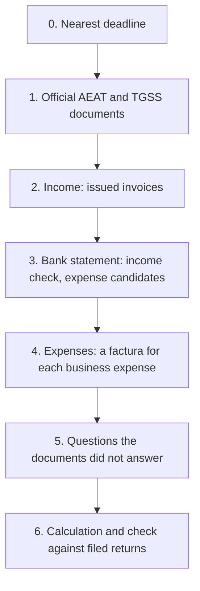

*Translated from the Russian original [docs/onboarding.md](../onboarding.md) on 13.10.2026. The Russian file is the source of truth; facts were checked as of the date stated below.*

# Onboarding: what to upload, what to ask, what to clarify

The canonical order for a new autónomo profile. The goal is to fill in all returns for the year
from documents, not from the user's memory. The rule: **an official document outweighs an answer to a question,
and an answer to a question outweighs a guess that gestor makes from the bank statement.** Each guess is shown to the user for
confirmation. A guess never enters the calculation silently.

## 0. Nearest deadline

First of all, gestor names the nearest filing deadline (usually the 20th day after the quarter) and what is needed for it.
If less than 15 days are left before the deadline, steps 1–4 are done only for that quarter. The rest is done after filing.

## 1. Official documents (upload PDF)

These documents answer most of the questionnaire and set the truth. All of them can be downloaded with Cl@ve.

| Document | Where to get it | What gestor takes from it |
|---|---|---|
| Certificado de situación censal | Sede AEAT → Certificados → Censales | Name, NIE, domicilio fiscal, alta date, epígrafe IAE, IVA and IRPF regime, ROI (EU transactions), **the list of obligations the AEAT expects**, which is checked against "What you file" |
| Returns filed for the current and the previous year (303, 130, 349, 390, 347, 100 or 151) | Sede AEAT → Mis expedientes / Consulta de declaraciones presentadas | "Filed" marks with amounts, IVA a compensar, net income of the previous year (casilla 13 in the 130, the 70 % exemption) |
| Modelo 149 and the decision on it | Sede AEAT, the same section | Whether the régimen Beckham applies and from which year |
| Informe de situación / bases de cotización | Import@ss (TGSS) | Date of alta in RETA, current base, tarifa plana period |
| Residence permit (TIE) | from the user | Type of visa or residence permit, validity period |
| Certificate of payment NRCs (if the statement has a "Tax payment" without an explanation) | Sede AEAT → Pagos → Consulta de NRC | Which return this payment paid |

If a document is missing, the question from step 5 is asked instead, and the answer is marked "according to the user".

## 2. Income (upload)

- All invoices (facturas emitidas) for the year in PDF: number, date, client, amount, currency.
- The invoice series and the last invoice number used with the previous gestor: numbering continues without gaps.
- For each client: full name, address, country, tax number (VAT ID for the EU), company or private individual.
- The contract with the client, if the place where the service is supplied is not obvious.

## 3. Bank statement (upload xlsx or csv)

The statement is not a document for the tax office. It is needed for two checks:

1. **Each incoming payment from a client ↔ an invoice.** An incoming payment without an invoice is a question to the user: is it payment for work, a refund, a transfer from a relative, personal money?
2. **Candidates for business expenses.** gestor sorts the debits into groups and asks only about the doubtful ones:
   - certainly business: TGSS contributions (RETA), gestoría services, tax payments (not an expense, but a check against the returns);
   - possibly business: software and subscriptions, phone and internet, coworking, trips, equipment;
   - household, partly deductible with a home office: rent, electricity, water (share of the floor area; for utilities, 30 % of that share);
   - personal: food, entertainment, transfers to people, cash.

The bank fee for an incoming transfer is a business expense if the transfer is payment of an invoice.

## 4. Expenses (upload)

- For each business expense: a factura completa issued to the user's NIE. A receipt or a statement line is not enough.
- For a home office: floor area of the work room and of the flat in m², the rental contract, bills for electricity, water, internet.
- For equipment over 300 €: purchase date and factura (amortisation).

## 5. Questions the documents did not answer

Ask only what is not in the documents from steps 1–4. Each question explains what the answer affects.

1. Where do you live and since what date; do you plan to move to another region (the IRPF region for the year is where you spend more days).
2. Do you work from home: which room, how many m² of the total floor area.
3. Which insurance do you pay: an autónomo's health insurance is deductible up to 500 € per year.
4. Which phone lines and subscriptions are used only for work.
5. Were there business trips: dates, purpose, client.
6. Do you have accounts, securities or real estate abroad worth more than 50 000 € in one block (Modelo 720, general regime).
7. Did you work as an employee for the same client before starting the activity (the 20 % reduction for new activities).
8. Did you tell your Spanish clients about the 7 % withholding rate.

## 6. Calculation and check

1. gestor fills in the profile and shows "How gestor understood you". The user confirms or corrects it.
2. "What you file" is checked against the list of obligations from the certificado censal. Any difference is a separate question.
3. The recalculated returns are compared with the amounts filed. The difference is explained line by line: which invoice or expense caused it.
4. Only after this does gestor show the calculation of the nearest quarter for filing.

## What gestor does not do

- It does not file returns and does not pay: the user copies the casillas into the Sede.
- It does not keep the whole statement: only the income and expenses confirmed by the user remain from it.
- It does not accept a guess from the statement without the user's confirmation.
