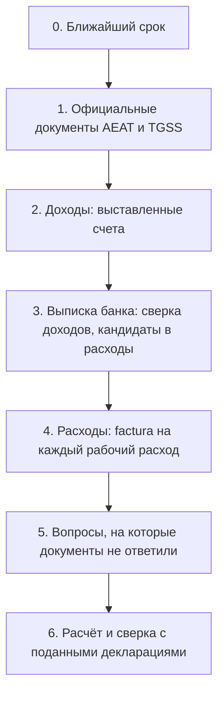

# Онбординг: что загрузить, что спросить, что уточнить

Канонический порядок для нового профиля autónomo. Цель — заполнить все декларации года
по документам, а не по памяти пользователя. Правило: **официальный документ важнее ответа на вопрос,
ответ на вопрос важнее догадки gestor по выписке.** Каждая догадка показывается пользователю на
подтверждение и не попадает в расчёт молча.

## 0. Ближайший срок

Первым делом gestor называет ближайший срок подачи (обычно 20-е число после квартала) и что для него нужно.
Если до срока меньше 15 дней, шаги 1–4 делаются только для этого квартала, остальное — после подачи.

## 1. Официальные документы (загрузить PDF)

Эти документы отвечают на большую часть анкеты и задают истину. Все скачиваются с Cl@ve.

| Документ | Где взять | Что из него берёт gestor |
|---|---|---|
| Certificado de situación censal | Sede AEAT → Certificados → Censales | Имя, NIE, domicilio fiscal, дата alta, epígrafe IAE, режим IVA и IRPF, ROI (операции с ЕС), **список обязательств, которые ждёт AEAT** — сверяется с «Что вы подаёте» |
| Поданные декларации за текущий и прошлый год (303, 130, 349, 390, 347, 100 или 151) | Sede AEAT → Mis expedientes / Consulta de declaraciones presentadas | Отметки «подано» с суммами, IVA a compensar, чистый доход прошлого года (casilla 13 в 130, освобождение 70 %) |
| Modelo 149 и решение по нему | Sede AEAT, тот же раздел | Действует ли режим Beckham и с какого года |
| Informe de situación / bases de cotización | Import@ss (TGSS) | Дата alta в RETA, текущая база, период tarifa plana |
| Разрешение на пребывание (TIE) | у пользователя | Вид визы или ВНЖ, срок действия |
| Справка о NRC платежей (если в выписке есть «Tax payment» без пояснения) | Sede AEAT → Pagos → Consulta de NRC | Какая декларация оплачена этим платежом |

Если документа нет, вопрос из шага 5 задаётся вместо него, а ответ помечается «со слов пользователя».

## 2. Доходы (загрузить)

- Все счета (facturas emitidas) за год в PDF: номер, дата, клиент, сумма, валюта.
- Серия и последний номер счёта у прежнего gestor: нумерация продолжается без пропусков.
- По каждому клиенту: полное название, адрес, страна, налоговый номер (VAT ID для ЕС), компания или частное лицо.
- Договор с клиентом, если место оказания услуги неочевидно.

## 3. Выписка банка (загрузить xlsx или csv)

Выписка — не документ для налоговой. Она нужна для двух сверок:

1. **Каждое поступление от клиента ↔ счёт.** Поступление без счёта — вопрос пользователю: это оплата работы, возврат, перевод от родственника, личные деньги?
2. **Кандидаты в рабочие расходы.** gestor раскладывает списания на группы и спрашивает только про спорные:
   - точно рабочие: взносы TGSS (RETA), услуги gestoría, налоговые платежи (не расход, а сверка с декларациями);
   - возможно рабочие: софт и подписки, телефон и интернет, коворкинг, поездки, техника;
   - домашние, частично вычитаемые при домашнем офисе: аренда, электричество, вода (доля площади, для коммунальных — 30 % доли);
   - личные: еда, развлечения, переводы людям, наличные.

Банковская комиссия за входящий перевод — рабочий расход, если перевод — оплата счёта.

## 4. Расходы (загрузить)

- На каждый рабочий расход — factura completa на NIE пользователя. Чек или строка выписки не подходят.
- Для домашнего офиса: площадь рабочей комнаты и квартиры в м², договор аренды, счета за свет, воду, интернет.
- Для техники дороже 300 €: дата покупки и factura (амортизация).

## 5. Вопросы, на которые документы не ответили

Спрашивать только то, чего нет в документах шагов 1–4. Каждый вопрос объясняет, на что влияет ответ.

1. Где вы живёте и с какой даты; планируется ли переезд в другой регион (регион IRPF года — где больше дней).
2. Работаете ли из дома: какая комната, сколько м² из общей площади.
3. Какие страховки платите: медицинская страховка autónomo вычитается до 500 € в год.
4. Какие телефонные линии и подписки используются только для работы.
5. Были ли рабочие поездки: даты, цель, клиент.
6. Есть ли счета, ценные бумаги или недвижимость за рубежом больше 50 000 € в одном блоке (Modelo 720, общий режим).
7. Работали ли наёмным у того же клиента до начала деятельности (снижение 20 % для новых).
8. Сообщали ли испанским клиентам о ставке удержания 7 %.

## 6. Расчёт и сверка

1. gestor заполняет профиль и показывает «Как gestor вас понял». Пользователь подтверждает или правит.
2. «Что вы подаёте» сверяется со списком обязательств из certificado censal. Расхождение — отдельный вопрос.
3. Пересчитанные декларации сравниваются с поданными суммами. Разница объясняется по строкам: какой счёт или расход её дал.
4. Только после этого gestor показывает расчёт ближайшего квартала к подаче.

## Чего gestor не делает

- Не подаёт декларации и не платит: пользователь сам переносит casillas в Sede.
- Не хранит выписку целиком: из неё остаются только подтверждённые пользователем доходы и расходы.
- Не принимает догадку по выписке без подтверждения пользователя.
