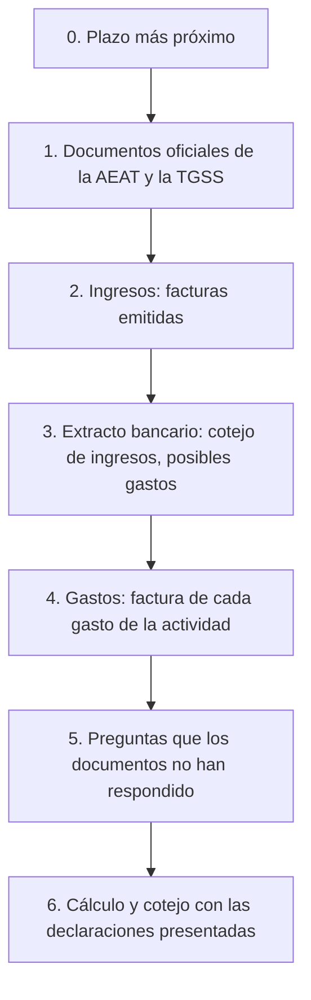

# Alta de un perfil: qué subir, qué preguntar, qué aclarar

Orden canónico para un perfil nuevo de autónomo. El objetivo es rellenar todas las declaraciones del año
a partir de documentos, no de la memoria del usuario. Regla: **un documento oficial vale más que la respuesta a una pregunta,
y la respuesta a una pregunta vale más que una suposición de gestor a partir del extracto.** Cada suposición se muestra al usuario para
que la confirme. Ninguna suposición entra en el cálculo sin avisar.

## 0. Plazo más próximo

Lo primero que hace gestor es indicar el plazo de presentación más próximo (normalmente el día 20 tras el trimestre) y lo que hace falta para él.
Si quedan menos de 15 días, los pasos 1–4 se hacen solo para ese trimestre. El resto, después de presentar.

## 1. Documentos oficiales (subir en PDF)

Estos documentos responden a la mayor parte del cuestionario y fijan la verdad. Todos se descargan con Cl@ve.

| Documento | Dónde obtenerlo | Qué toma gestor de él |
|---|---|---|
| Certificado de situación censal | Sede AEAT → Todas las gestiones → Certificados → Censales → Situación Censal | Nombre, NIE, domicilio fiscal, fecha de alta, epígrafe IAE, régimen de IVA e IRPF, Registro de Operadores Intracomunitarios (ROI), **lista de obligaciones que espera la AEAT**: se coteja con «Qué presenta» |
| Declaraciones presentadas del año en curso y del año anterior (303, 130, 349, 390, 347, 100 o 151) | Sede AEAT → Área personal → Mis expedientes → Consultar declaraciones presentadas | Marcas de «presentada» con importes, cuotas de IVA a compensar, rendimiento neto del año anterior (casilla 13 del 130, exención del 70 %) |
| Modelo 149 y la resolución sobre él | Sede AEAT, la misma sección | Si el régimen Beckham está vigente y desde qué año |
| Informe de situación / bases de cotización | Import@ss (TGSS) | Fecha de alta en el RETA, base actual, periodo de tarifa plana |
| Autorización de residencia (TIE) | la tiene el usuario | Tipo de visado o de autorización de residencia, vigencia |
| Consulta del NRC de los pagos (si en el extracto hay un «Tax payment» sin explicación) | Sede AEAT → Pagar, aplazar y consultar → Consultar deudas → Consulta pagos anteriores y Anulación Nrcs | Qué declaración se pagó con ese pago |

Si falta un documento, en su lugar se hace la pregunta del paso 5. La respuesta se marca como «según el usuario».

## 2. Ingresos (subir)

- Todas las facturas emitidas del año en PDF: número, fecha, cliente, importe, moneda.
- Serie y último número de factura con el gestor anterior: la numeración continúa sin saltos.
- De cada cliente: nombre completo, dirección, país, número fiscal (VAT ID para la UE), si es empresa o particular.
- Contrato con el cliente, si el lugar de prestación del servicio no es evidente.

## 3. Extracto bancario (subir en xlsx o csv)

El extracto no es un documento para Hacienda. Sirve para dos cotejos:

1. **Cada cobro de un cliente ↔ una factura.** Un cobro sin factura genera una pregunta al usuario: ¿es el pago de un trabajo, una devolución, una transferencia de un familiar, dinero personal?
2. **Posibles gastos de la actividad.** gestor agrupa los cargos y solo pregunta por los dudosos:
   - seguro que son de la actividad: cuotas a la TGSS (RETA), servicios de gestoría, pagos de impuestos (no son gasto, sirven para cotejar con las declaraciones);
   - posiblemente de la actividad: software y suscripciones, teléfono e internet, coworking, viajes, equipos;
   - domésticos, deducibles en parte si trabaja desde casa: alquiler, electricidad, agua (proporción de la superficie; para los suministros, el 30 % de esa proporción);
   - personales: comida, ocio, transferencias a personas, efectivo.

La comisión bancaria por una transferencia recibida es un gasto de la actividad si la transferencia es el pago de una factura.

## 4. Gastos (subir)

- Para cada gasto de la actividad: factura completa a nombre del NIE del usuario. Un tique o una línea del extracto no sirven.
- Para el despacho en casa: superficie de la habitación de trabajo y de la vivienda en m², contrato de alquiler, facturas de luz, agua e internet.
- Para equipos de más de 300 €: fecha de compra y factura (amortización).

## 5. Preguntas que los documentos no han respondido

Pregunte solo lo que no está en los documentos de los pasos 1–4. Cada pregunta explica en qué influye la respuesta.

1. Dónde vive y desde qué fecha; si tiene previsto mudarse a otra comunidad (la comunidad del IRPF del año es aquella en la que pasa más días).
2. Si trabaja desde casa: qué habitación, cuántos m² de la superficie total.
3. Qué seguros paga: el seguro médico del autónomo se deduce hasta 500 € al año.
4. Qué líneas de teléfono y suscripciones usa solo para trabajar.
5. Si ha hecho viajes de trabajo: fechas, motivo, cliente.
6. Si tiene cuentas, valores o inmuebles en el extranjero por más de 50 000 € en un mismo bloque (Modelo 720, régimen general).
7. Si trabajó por cuenta ajena para el mismo cliente antes de iniciar la actividad (reducción del 20 % para nuevos autónomos).
8. Si comunicó a sus clientes españoles el tipo de retención del 7 %.

## 6. Cálculo y cotejo

1. gestor rellena el perfil y muestra «Cómo le ha entendido gestor». El usuario lo confirma o lo corrige.
2. «Qué presenta» se coteja con la lista de obligaciones del certificado de situación censal. Cada diferencia es una pregunta aparte.
3. Las declaraciones recalculadas se comparan con los importes presentados. La diferencia se explica línea por línea: qué factura o qué gasto la ha producido.
4. Solo después gestor muestra el cálculo del trimestre más próximo para presentar.

## Qué no hace gestor

- No presenta declaraciones ni paga: el usuario copia él mismo las casillas en la Sede electrónica de la AEAT.
- No guarda el extracto completo: de él solo quedan los ingresos y gastos que el usuario ha confirmado.
- No acepta una suposición basada en el extracto sin la confirmación del usuario.
