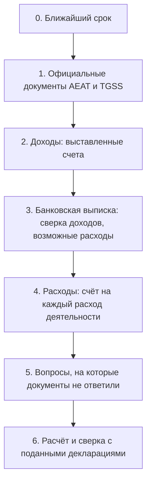

*Переведено с испанского оригинала [docs/onboarding.md](../onboarding.md) 13.10.2026. Источник истины — испанский файл.*

# Создание профиля: что загрузить, что спросить, что уточнить

Канонический порядок для нового профиля autónomo. Цель: заполнить все декларации года
по документам, а не по памяти пользователя. Правило: **официальный документ важнее ответа на вопрос,
а ответ на вопрос важнее предположения gestor по банковской выписке.** Каждое предположение показывается пользователю,
чтобы он его подтвердил. Ни одно предположение не входит в расчёт без предупреждения.

## 0. Ближайший срок

Первым делом gestor показывает ближайший срок подачи (обычно 20-е число после квартала) и то, что для него нужно.
Если осталось меньше 15 дней, шаги 1–4 делаются только для этого квартала. Остальное делается после подачи.

## 1. Официальные документы (загрузить в PDF)

Эти документы отвечают на большую часть анкеты и фиксируют истину. Все они скачиваются через Cl@ve.

| Документ | Где получить | Что gestor из него берёт |
|---|---|---|
| Certificado de situación censal | Sede AEAT → Todas las gestiones → Certificados → Censales → Situación Censal | Имя, NIE, налоговый адрес (domicilio fiscal), дата alta, эпиграф IAE, режим IVA и IRPF, Registro de Operadores Intracomunitarios (ROI), **список обязанностей, которых ждёт AEAT**: его сверяют с «Что вы подаёте» |
| Поданные декларации текущего и прошлого года (303, 130, 349, 390, 347, 100 или 151) | Sede AEAT → Área personal → Mis expedientes → Consultar declaraciones presentadas | Отметки «подана» с суммами, суммы IVA a compensar, чистый доход прошлого года (casilla 13 в 130, освобождение по правилу 70 %) |
| Modelo 149 и решение по нему | Sede AEAT, тот же раздел | Действует ли régimen Beckham и с какого года |
| Справка о статусе / bases de cotización (Informe de situación / bases de cotización) | Import@ss (TGSS) | Дата alta в RETA, текущая база, период tarifa plana |
| Разрешение на проживание (TIE) | есть у пользователя | Тип визы или разрешения на проживание, срок действия |
| Проверка NRC платежей (если в выписке есть «Tax payment» без объяснения) | Sede AEAT → Pagar, aplazar y consultar → Consultar deudas → Consulta pagos anteriores y Anulación Nrcs | За какую декларацию был этот платёж |

Если документа нет, вместо него задаётся вопрос из шага 5. Ответ помечается как «со слов пользователя».

## 2. Доходы (загрузить)

- Все выставленные счета года в PDF: номер, дата, клиент, сумма, валюта.
- Серия и последний номер счёта у прежнего бухгалтера (gestor): нумерация продолжается без пропусков.
- По каждому клиенту: полное имя, адрес, страна, налоговый номер (VAT ID для ЕС), компания это или частное лицо.
- Договор с клиентом, если место оказания услуги не очевидно.

## 3. Банковская выписка (загрузить в xlsx или csv)

Выписка не является документом для налоговой (Hacienda). Она нужна для двух сверок:

1. **Каждое поступление от клиента ↔ один счёт.** Поступление без счёта порождает вопрос пользователю: это оплата работы, возврат, перевод от родственника, личные деньги?
2. **Возможные расходы деятельности.** gestor группирует списания и спрашивает только про сомнительные:
   - точно относятся к деятельности: взносы в TGSS (RETA), услуги gestoría, налоговые платежи (это не расход, они нужны для сверки с декларациями);
   - возможно относятся к деятельности: программы и подписки, телефон и интернет, коворкинг, поездки, оборудование;
   - бытовые, частично вычитаются, если вы работаете из дома: аренда, электричество, вода (доля площади; для коммунальных услуг 30 % от этой доли);
   - личные: еда, досуг, переводы людям, наличные.

Банковская комиссия за входящий перевод — это расход деятельности, если перевод является оплатой счёта.

Эту сверку делает ваш агент через MCP-сервер: в Claude Code — `/mcp__gestor__statement`, в Codex — просьба «сверь выписку с gestor». Агент читает файл сам; gestor выписку не хранит. Для поступления без счёта агент предлагает клиента и черновик счёта: дата операции — когда сделана работа, дата счёта — сегодня. Выставляет счёт пользователь в интерфейсе.

Для списаний агент просит factura и предлагает расход по ней; взнос RETA и банковские комиссии он предлагает прямо из строки выписки (подтверждающие документы: recibo TGSS, его можно скачать в Import@ss, и расчёт банка). Коммунальные услуги при домашнем офисе (30 % × доля площади), аренду квартиры (доля площади рабочей комнаты) и питание в поездках агент считает только по вашим м² и поездкам; он их не угадывает.

## 4. Расходы (загрузить)

- На каждый расход деятельности: полный счёт (factura) на NIE пользователя. Чек (tique) или строка выписки не подходят.
- Для кабинета дома: площадь рабочей комнаты и жилья в м², договор аренды, счета за свет, воду и интернет.
- Для оборудования дороже 300 €: дата покупки и счёт (амортизация).

## 5. Вопросы, на которые документы не ответили

Спрашивайте только то, чего нет в документах из шагов 1–4. Каждый вопрос объясняет, на что влияет ответ.

1. Где вы живёте и с какой даты; собираетесь ли переехать в другое автономное сообщество (сообщество для IRPF за год — то, где вы проводите больше всего дней).
2. Если вы работаете из дома: какая комната, сколько м² от общей площади.
3. Какие страховки вы оплачиваете: медицинская страховка autónomo вычитается до 500 € в год.
4. Какие телефонные линии и подписки вы используете только для работы.
5. Были ли рабочие поездки: даты, цель, клиент.
6. Есть ли у вас за границей счета, ценные бумаги или недвижимость больше чем на 50 000 € в одном блоке (Modelo 720, общий режим).
7. Работали ли вы по найму на того же клиента до начала деятельности (уменьшение на 20 % для новых autónomos).
8. Сообщили ли вы испанским клиентам о ставке удержания 7 %.

## 6. Расчёт и сверка

1. gestor заполняет профиль и показывает «Как gestor вас понял». Пользователь подтверждает или исправляет.
2. «Что вы подаёте» сверяется со списком обязанностей из certificado de situación censal. Каждое расхождение — отдельный вопрос.
3. Пересчитанные декларации сравниваются с поданными суммами. Разница объясняется построчно: какой счёт или какой расход её дал.
4. Только после этого gestor показывает расчёт ближайшего квартала для подачи.

## Чего gestor не делает

- Не подаёт декларации и не платит: пользователь сам переносит casillas в Sede electrónica AEAT.
- Не хранит выписку целиком: из неё остаются только доходы и расходы, которые подтвердил пользователь.
- Не принимает предположение по выписке без подтверждения пользователя.
